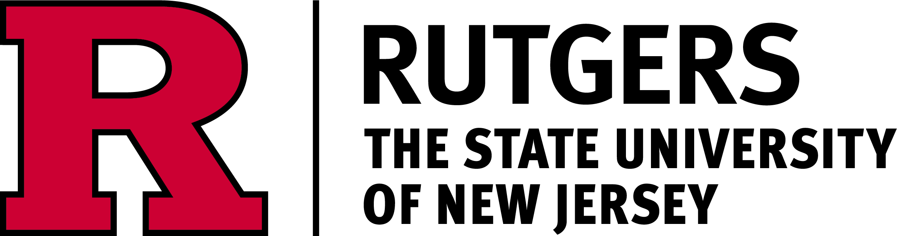
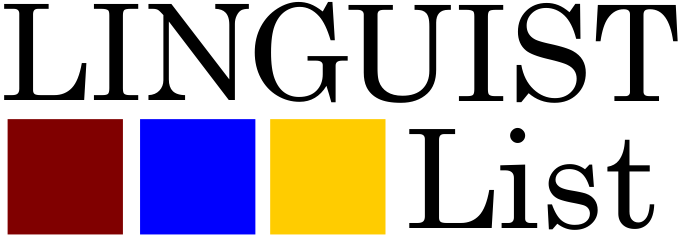

___
We are pleased to announce that the **12th iteration of the Workshop on Turkic and Languages in Contact with Turkic** (TU+12) will be hosted by the Department of Linguistics at Rutgers University. The workshop will be held at Rutgers University in New Brunswick, NJ, on April 17-18, 2027 in-person. The abstract submissions are now open.  
TU+ is an annual workshop focusing on all aspects of linguistic research on **Turkic languages**, as well as on **languages in contact with Turkic and on languages spoken in regions where Turkic languages are spoken**. TU+ showcases theoretically informed and data-driven work across phonology, morphology, syntax, semantics, pragmatics, psycholinguistics, neurolinguistics, historical linguistics, and computational approaches. **This year we would like to especially encourage phonologically- and phonetically-oriented contributions**. 

::: {.panel.panel-default}

::: {.panel-heading style="background-color: #CC0033; color: white; border-color: #CC0033;"}
**ⓘ Note**
:::

::: {.panel-body}
Since 2019, papers presented at TU+ have been invited to appear in an online proceedings volume distributed by the Linguistic Society of America.
:::

:::

### Invited Speakers

---

- [Michael Fiddler](https://sites.google.com/view/michaelfiddler) (Boğaziçi University)
- [Deepthi Gopal](https://deepthigop.al) (UiT the Arctic University of Norway and Uppsala University)
- [Eszter Ótott-Kovács](https://eszterotottkovacs.ca) (University of Toronto)   

### Important Dates

---

:::: {style="width: 100%; margin-bottom: 35px;"}

::: {style="display: grid; grid-template-columns: 35% 65%; padding: 0px 0; border-bottom: 1px solid #999; font-weight: bold;"}

Milestone

Date

:::

::: {style="display: grid; grid-template-columns: 35% 65%; padding: 0px 0; border-bottom: 1px solid #ddd;"}

*abstract submission deadline*

**December 22, 2026** - 11:59 PM EST

:::

::: {style="display: grid; grid-template-columns: 35% 65%; padding: 0px 0; border-bottom: 1px solid #ddd;"}

*notification of acceptance*

**January 31, 2027** - 11:59 PM EST

:::

::: {style="display: grid; grid-template-columns: 35% 65%; padding: 0px 0; border-bottom: 1px solid #ddd;"}

*workshop*

**April 17–18, 2027**

:::

::::

 

---

:::: {style="display: grid; grid-template-columns: repeat(2, minmax(0, 1fr)); column-gap: 40px; align-items: start;"}

::: {style="min-width: 0;"}

### Code of Conduct

Please review our [**Code of Conduct**](https://turkicworkshop.github.io/tu12/codeofconduct) before participating.   

### Organizing Committee

**Student Organisers (Rutgers)**

- Zoe Katz `zoe.katz@rutgers.edu`
- Colin Hirschbirg `ckh51@scarletmail.rutgers.edu`
- Utku Zobarlar `utku.zobarlar@rutgers.edu`
- Merlin Balkhash `merlin.udinov@rutgers.edu`

**Faculty Advisor**

- [Adam McCollum](https://www.adammccollum.net) (Rutgers)

:::

::: {style="min-width: 0;"}

### Permanent Site

For information on earlier editions, [proceedings](https://journals.linguisticsociety.org/proceedings/index.php/tu/issue/archive), and history, see the [permanent site](https://turkicworkshop.github.io).  

### Questions?

Email the organisers at [turkicworkshop12@gmail.com](mailto:turkicworkshop12@gmail.com). We're happy to help with submissions, accessibility, and logistics. You can also join our [Google Groups](https://docs.google.com/forms/d/e/1FAIpQLSdBsOA96yFu-HrBacZrX1COA1abtx_p5CxpDqzc5pkbowjrCA/viewform) to receive updates.  

::: {style="text-align: center;"}

{width=50%}

 

{width=50%}]

:::

:::

::::